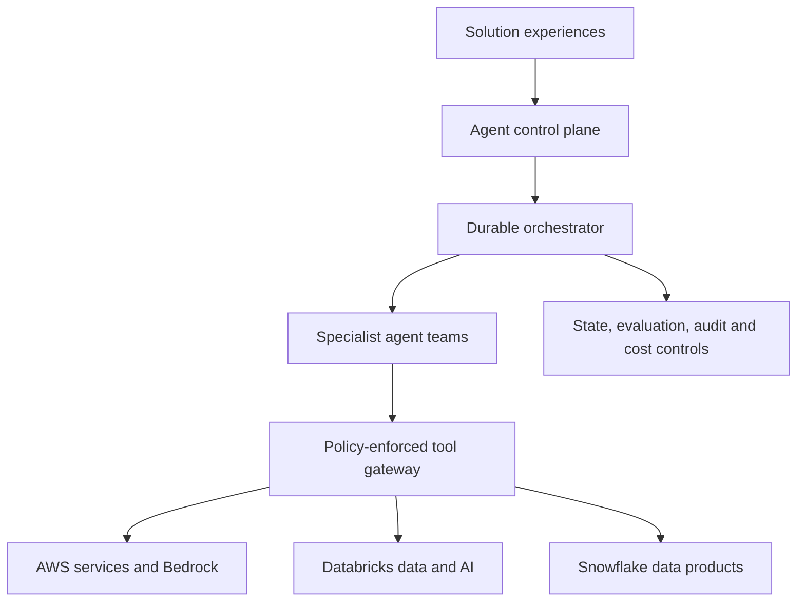

# Multi-agent solutions architecture

The product is a reusable platform for multiple agentic solutions—not a single chatbot or knowledge application.

## Logical layers

| Layer | Responsibilities |
|---|---|
| Solution experience | Domain-specific UI, API, and human approval interactions |
| Control plane | Solution/agent registry, versions, prompts, tool grants, model policy, deployment lifecycle |
| Orchestration | Plans work, delegates to agents, persists checkpoints, handles retries/timeouts, and requests human approval |
| Agent runtime | Supervisor, specialist, and validator agents with narrow roles and bounded execution |
| Tool gateway | MCP and native tool catalog, schema validation, authorization, rate limits, and output filtering |
| Data and AI | Bedrock models; Databricks processing/evaluation/ML; Snowflake governed enterprise data products |
| Governance | Identity, least privilege, policy, lineage, traces, quality gates, budgets, and immutable audit records |

## Platform rules

1. An agent is an independently versioned platform asset that can be reused by many products.
2. A solution binds approved agent versions to product-specific workflows, tool grants, data policies, and evaluation suites.
3. Agents never receive platform-wide credentials; the tool gateway authorizes each invocation in the active product context.
4. The model may recommend an action but cannot grant authorization or approve its own high-risk action.
5. Workflow state is separate from conversational memory. Both have explicit retention and access policies.
6. Every delegated step records product, solution, agent version, model, prompt version, tool calls, latency, tokens, cost, and disposition.
7. Production promotion requires offline evaluation, security checks, budget limits, and human approval.

## Reuse model

`Agent definition` → immutable reusable behavior and maximum tool capabilities  
`Product binding` → exact agent version plus reduced tool grants and product data policy  
`Run context` → authenticated user, product, environment, purpose, and trace ID

An agent shared by Product A and Product B retains the same behavior version, but receives different scoped credentials, datasets, memory namespaces, budgets, and audit trails at runtime.

## Platform allocation

| Platform | Role in the product |
|---|---|
| GitHub | Monorepo, pull requests, agent definitions, IaC, CI/CD, supply-chain controls |
| AWS | Runtime, durable workflow/event services, Bedrock, IAM, KMS, Secrets Manager, monitoring |
| Databricks | Data engineering, embeddings when needed, AI experimentation, evaluation datasets and batch scoring |
| Snowflake | Governed structured data access, semantic/analytical data products, operational reporting |

Databricks and Snowflake are exposed to agents only through approved tools or services. They are not called directly using user-supplied credentials.

## First implementation increments

1. Control-plane API and durable solution registry
2. One orchestrated supervisor/specialist/validator workflow
3. Governed tool gateway with one AWS, one Databricks, and one Snowflake integration
4. Trace, cost, and evaluation schema
5. Human approval for consequential actions
6. First domain solution deployed to dev
